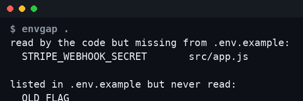

# envgap

Finds environment variables your code reads that `.env.example` doesn't mention,
and the other way round. Zero dependencies, one command.



```
$ npx github:TheRealAlexxx/envgap .
read by the code but missing from .env.example:
  STRIPE_WEBHOOK_SECRET       src/billing.js, src/hooks.js
listed in .env.example but never read:
  OLD_FEATURE_FLAG
```

Exit code 1 when something is read but undocumented (so it works in CI), 0
otherwise, 2 when there is no example file. `--json` for machine output.

## What it looks at

- Example file: `.env.example`, `.env.sample` or `.env.template`. A commented
  `# KEY=value` line counts as documented (an optional variable).
- Reads: `process.env.X`, `process.env["X"]`, `import.meta.env.X`,
  `os.environ[...]`/`.get`, `os.getenv`, `ENV[...]`/`ENV.fetch`, `os.Getenv`,
  `env::var`, `getenv`, and `$X`/`${X}` in `.sh` files. Names must be UPPER_CASE.
- Skips `node_modules`, `.git`, `dist`, `build`, `vendor` and similar.
- Ignores variables the platform sets: `NODE_ENV`, `PATH`, `HOME`, `CI`, etc.

## Limits

It only sees explicit reads. A library that reads `POSTGRES_URL` or `AUTH_SECRET`
on its own will show up under "never read". Try it on
`vercel/next-learn/dashboard/final-example`: all eight listed variables are read
by libraries, not by the app code. Treat that section as a prompt to check, not
an error. Dynamic names (`process.env[name]`) are not found.

## Tests

```
node --test
```

## License

MIT
